# DriftWM for Android

**An infinite desktop experience for Android**

DriftWM for Android is an independent community-developed port of [DriftWM](https://github.com/malbiruk/driftwm), bringing its desktop-inspired workspace concept to Android devices

Instead of a traditional grid of application icons, DriftWM gives you an open workspace where you can arrange application cards, organize your dock, customize the appearance, and make the desktop your own

## Screenshots

### Workspace

Your desktop is an open workspace where application cards can be freely arranged

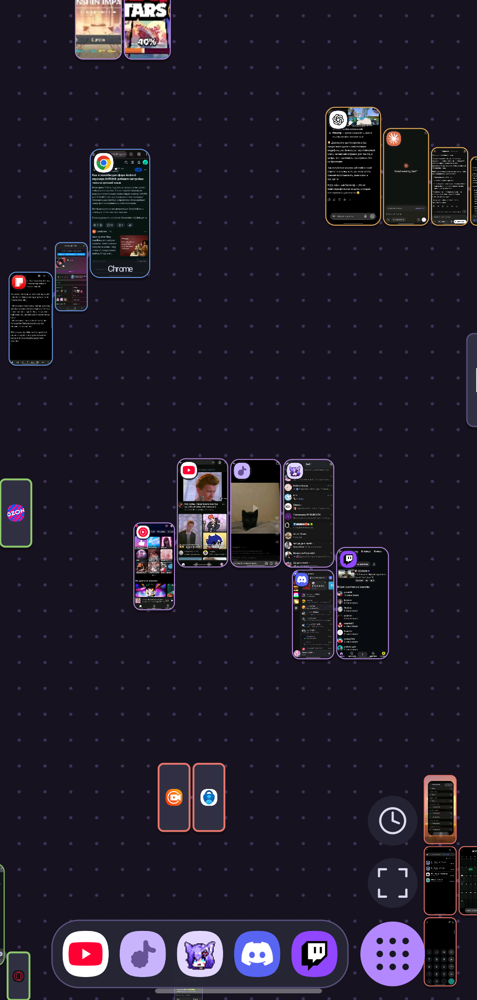

### Application List

Browse installed applications and access them from the launcher

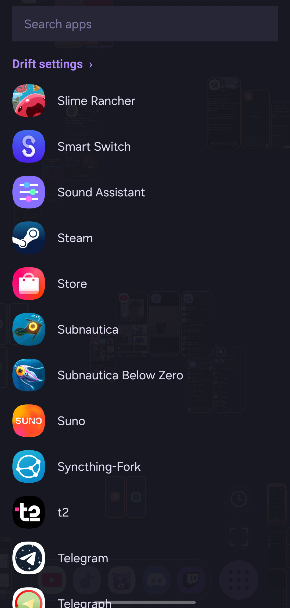

### Dock Folders

Keep your dock organized with folders

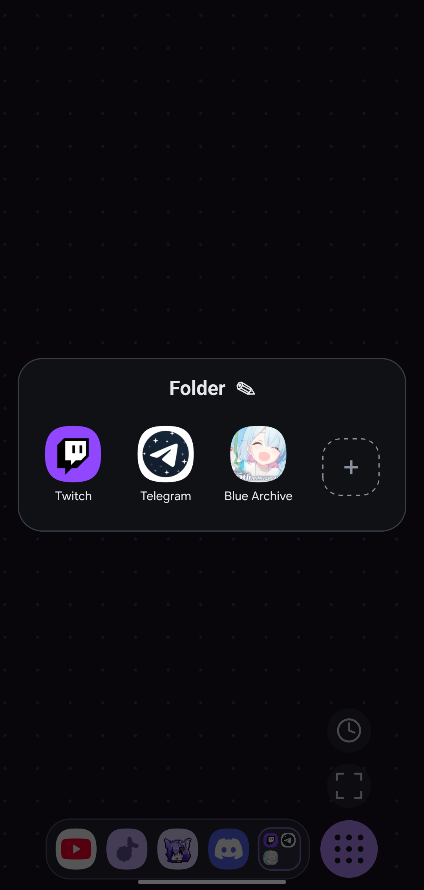

### Themes

Choose from six built-in interface themes

  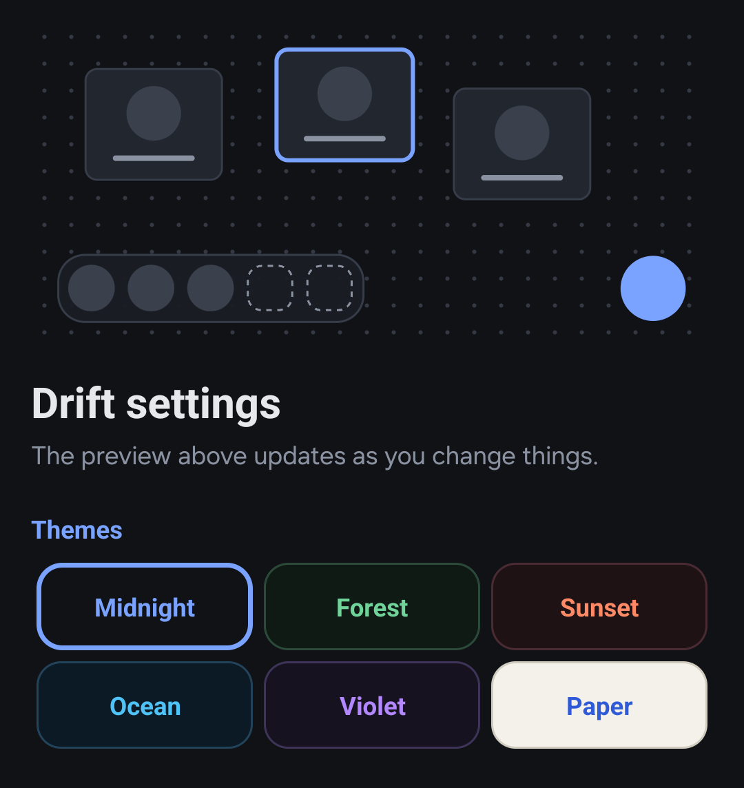
  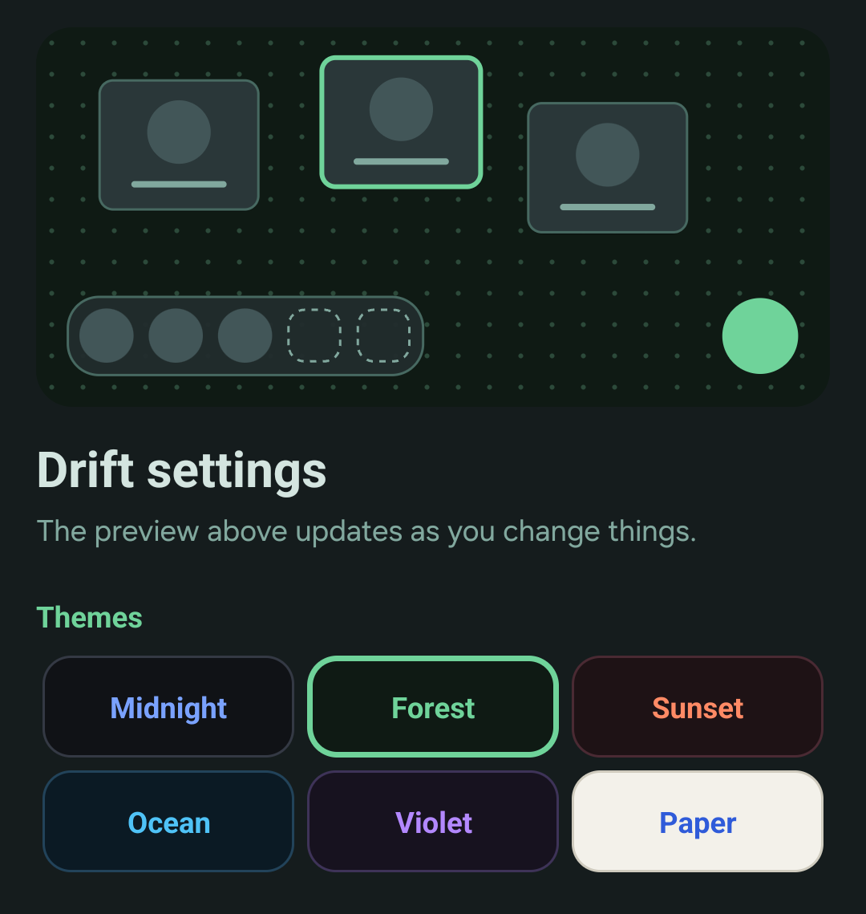
  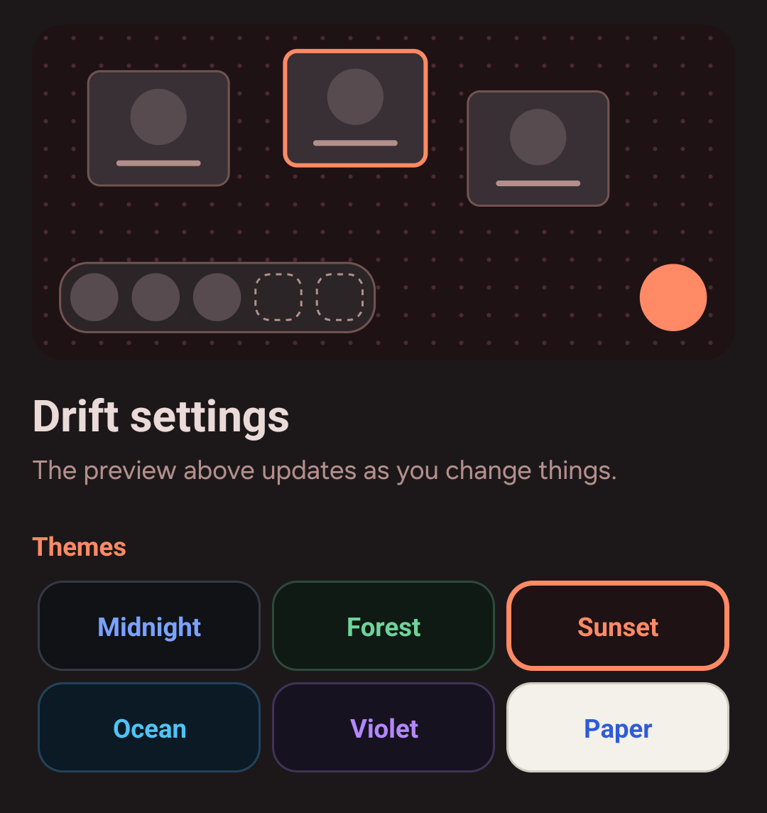

  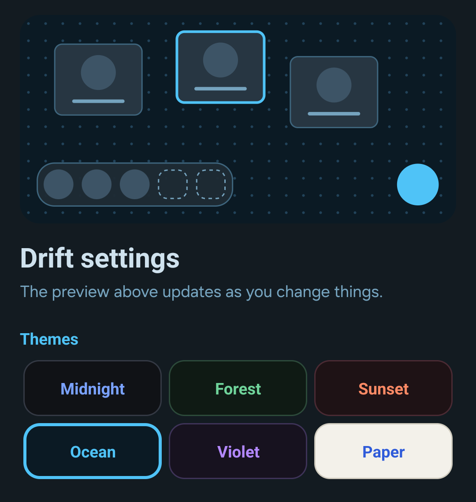
  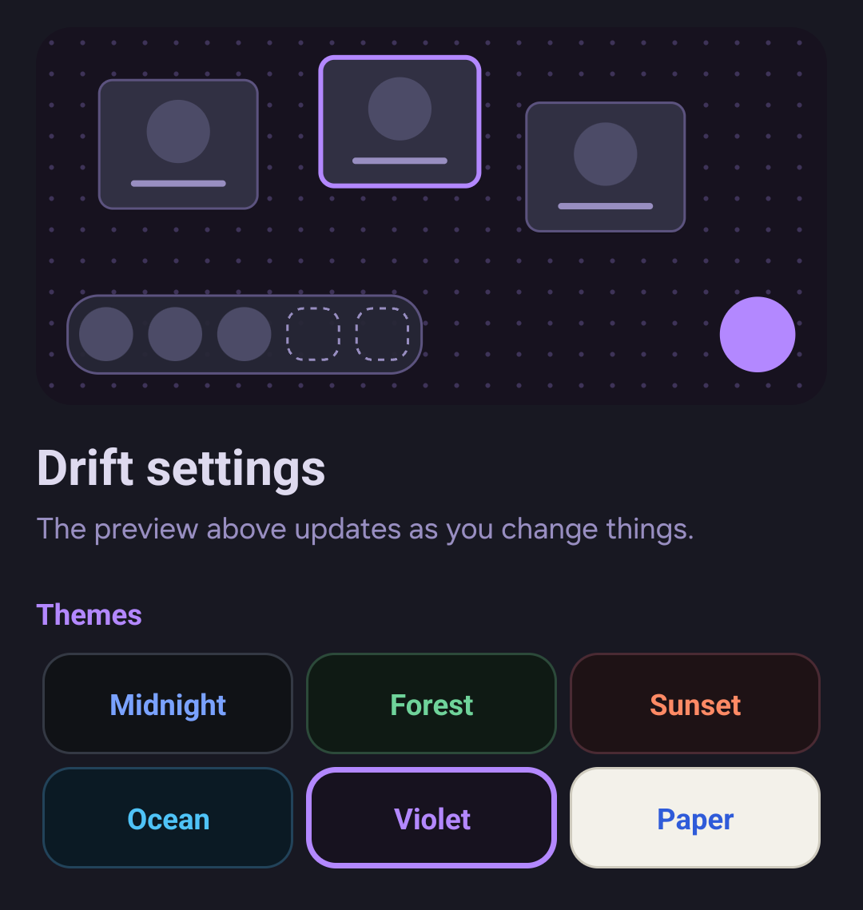
  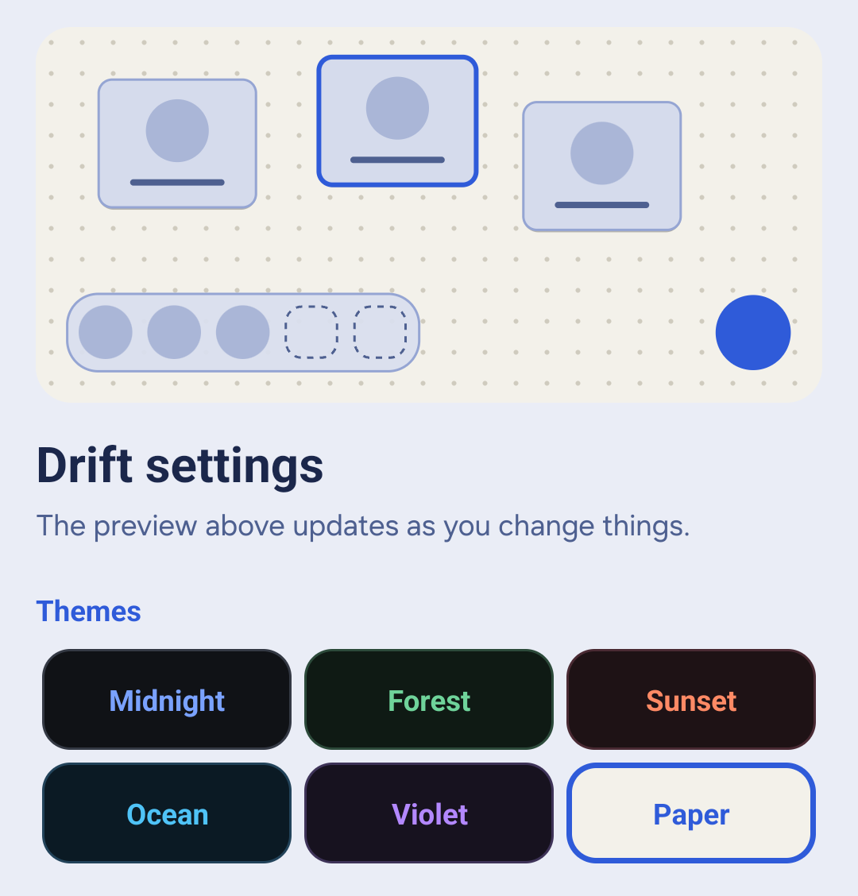

### Wallpapers

Customize your desktop with static or dynamic wallpapers

  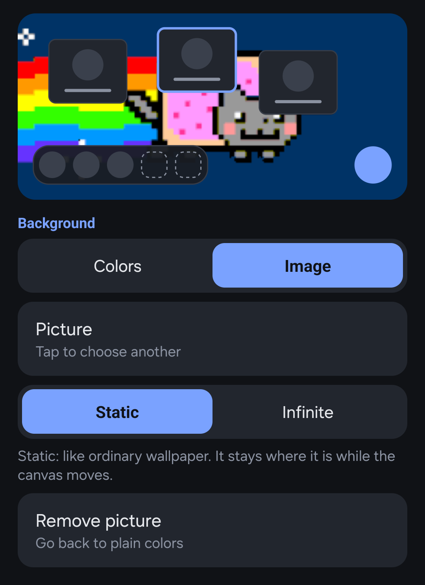
  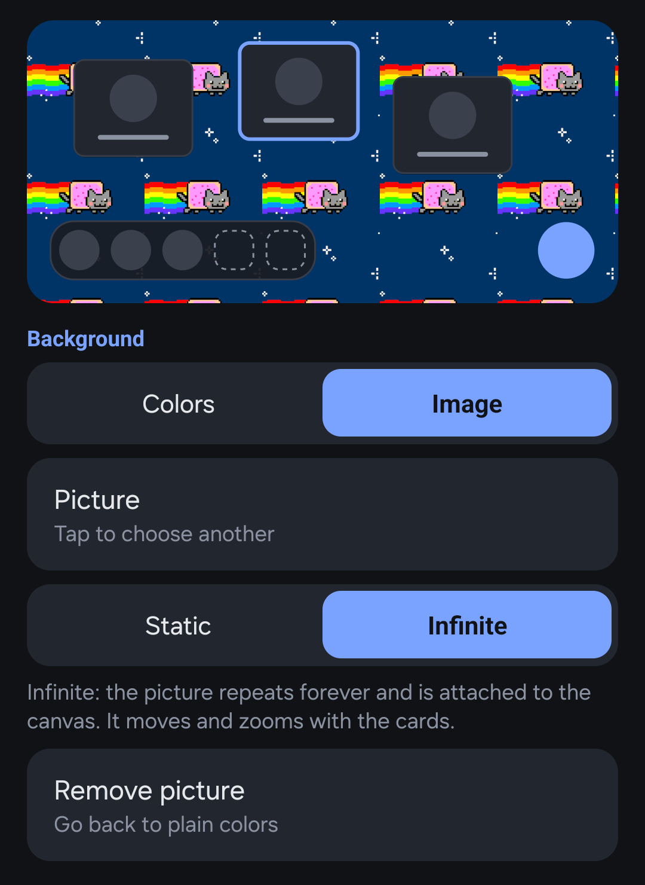

### Settings

Configure the launcher and customize its appearance

  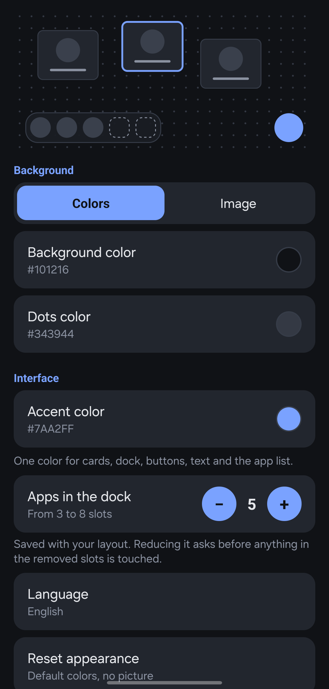
  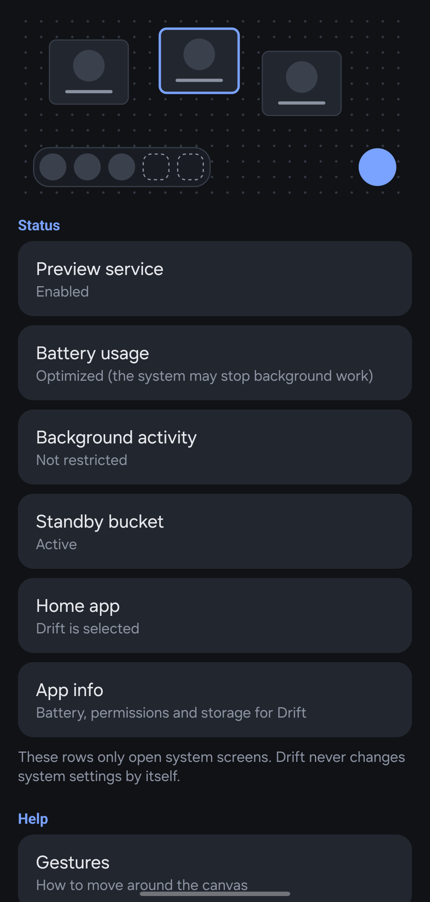
  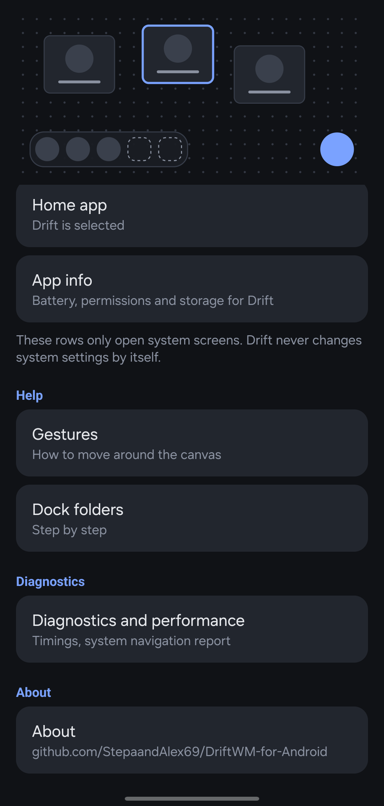

## Features

- **Infinite Workspace** — an open desktop where application cards can be freely positioned
- **Application Cards** — visual representations of your apps with thumbnails
- **Drag and Drop** — arrange cards and organize your workspace
- **Dock Folders** — group applications into folders directly in the dock
- **Customizable Dock** — choose between 3 and 8 dock slots
- **Application List** — access your installed applications
- **Themes** — six built-in interface themes
- **Custom Wallpapers** — use your own images or choose a solid background
- **Static and Dynamic Wallpapers** — configure how your desktop background behaves
- **Interface Customization** — adjust the appearance and accent colors

## Performance

DriftWM is designed with performance in mind, including:

- Optimized rendering and workspace updates
- Cached application icons
- Background processing for resource-intensive operations
- Efficient state persistence
- Reduced unnecessary application and system queries

The project aims to remain usable on a wide range of Android devices

## Requirements

- **Minimum Android version:** Android 11 (API 30)
- **Recommended Android version:** Android 16 (API 36)
- **Target SDK:** 36

Android 11 and newer are supported, although the experience may vary depending on the device and manufacturer

## Installation and Setup

### 1. Install DriftWM

1. Download the latest APK from [GitHub Releases](../../releases/latest)
2. Open the downloaded APK on your Android device
3. Allow installation from this source if Android asks for permission
4. Complete the installation

### 2. Set DriftWM as your default launcher

1. Open your phone's **Settings**
2. Find **Default apps**
3. Open **Home app** or **Default launcher**
4. Select **Drift**

The exact menu names may vary depending on your Android version and device manufacturer

### 3. Enable Drift Preview

Drift Preview provides application thumbnails for the workspace

1. Open your phone's **Settings**
2. Find **Accessibility**
3. Open the list of accessibility services
4. Enable **Drift Preview**

**Note:** This service is optional and only required for the thumbnail functionality. The launcher itself works without it

## Download

Get the latest version from [GitHub Releases](../../releases/latest)

## Device Compatibility

DriftWM has been tested on multiple real Android devices and different Android versions

Compatibility may vary depending on the device manufacturer, Android version, and system-specific launcher or accessibility implementations

If you encounter a problem, consider [opening an issue](../../issues) with information about your device and Android version

## Security Notice

Only install APK files downloaded from this project's official [GitHub Releases](../../releases/latest) page

Some device security scanners may occasionally display warnings during installation. Always verify that the APK comes from the official project repository

## Original Project

DriftWM for Android is based on the original [DriftWM](https://github.com/malbiruk/driftwm) project

The original project and its contributors deserve credit for the ideas and inspiration behind this port

## Disclaimer

This is an independent community fork and is not an official release of the original DriftWM project

## License

See the [LICENSE](LICENSE) file for licensing information